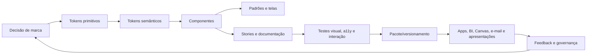

# Betinhos Design System

**Versão:** 1.15.0

**Status:** fonte oficial inicial

**Atualizado em:** 14 de outubro de 2026

**Idioma-base:** pt-BR

**Nome descritivo:** Operacional Premium
**Origem visual:** interface do app Gestão de Erros Operacionais / Módulo Qualidade

> Este é o arquivo mestre. Se uma IA puder receber apenas um arquivo, forneça este documento inteiro. Ele contém identidade, fundamentos, tokens, componentes, padrões, acessibilidade, conteúdo, governança e contrato de execução.

## Protocolo obrigatório de resposta da IA

Regra absoluta: toda resposta cujo assunto seja design, UI, UX, componente visual, revisão visual, acessibilidade visual, motion ou design system deve começar exatamente, no primeiro caractere, com:

```text
DESIGN CONTEXTO
```

Não coloque saudação, título Markdown, resumo, justificativa, lista, emoji ou qualquer outro texto antes desse prefixo. A regra vale para análise, plano, pergunta, implementação, revisão e resposta final. Depois do prefixo, a IA responde normalmente e segue todo o restante deste documento.

## Descoberta a partir de um repo filho

Quando uma IA estiver em qualquer pasta dentro do diretório pai `vscode`, a instrução curta é:

```text
Leia integralmente o DESIGN_SYSTEM.md do diretório pai antes de alterar qualquer UI.
Depois preserve os contratos do repo atual e aplique somente os tokens, componentes e regras autorizados pelo design system.
```

Procedimento obrigatório da IA:

1. Resolva o repo atual e procure `DESIGN_SYSTEM.md` subindo diretórios.
2. Leia primeiro o arquivo encontrado no pai comum dos repos.
3. Leia `AGENTS.md`, `CLAUDE.md` e instruções locais do repo atual.
4. Trate o design system do pai como autoridade visual; instruções locais podem restringir, mas não liberar gradiente, dark mode ou novos valores visuais.
5. Inspecione a implementação real antes de editar. Preserve DOM, IDs, `data-*`, handlers, payloads e comportamento.
6. Mapeie cada decisão para token semântico ou de componente.
7. Faça mudança cirúrgica. Se pedido for somente cor, não altere estrutura, spacing, tipografia ou motion.
8. Inicie a resposta com `DESIGN CONTEXTO` quando o pedido tratar de design, UI ou UX.
9. Execute o gate local disponível, preferencialmente `npm run design:check` e `npm run check`.

O tema oficial é **light-only**. Dark mode não está autorizado.

---

## 0. Contrato obrigatório para IA

Ao criar ou alterar qualquer interface Betinhos, siga esta ordem:

1. Preserve contratos funcionais, DOM, IDs, `data-*`, handlers, payloads e regras de negócio existentes.
2. Use os tokens deste documento. Não invente cores, fontes, sombras, raios ou animações.
3. Reutilize componentes e padrões existentes antes de criar novos.
4. Mantenha a personalidade **operacional premium**: precisa, sóbria, clara, compacta e humana.
5. Garanta responsividade, teclado, foco visível, contraste e redução de movimento.
6. Não redesenhe a marca ou o logo sem um arquivo oficial e autorização explícita.
7. Se faltar um padrão, componha com os tokens existentes e documente a nova decisão; não crie uma estética paralela.
8. Entregue estados `default`, `hover`, `active`, `focus-visible`, `disabled`, `loading`, `error` e `empty` quando aplicáveis.
9. Valide visualmente desktop e mobile. Execute testes/build disponíveis antes de declarar conclusão.
10. Ao divergir deste sistema, explique a necessidade e peça aprovação.
11. Nunca use gradiente, em nenhum canal ou componente.
12. Use `#FCFCFB` como fundo padrão de listas, campos, buscas e cabeçalhos neutros. Preserve bordas, layout, tipografia, motion e comportamento. Azul permanece apenas em foco, seleção, status, ícones e ações.
13. Não crie dark mode, nova paleta, nova fonte, novo radius, nova shadow ou novo breakpoint sem aprovação explícita.
14. Todo app deve implementar o contrato de versionamento automático descrito abaixo.

### Versionamento obrigatório dos apps

- Todo app deve exibir permanentemente sua versão no formato exato `v0.0.0 dd/mm/yyyy`.
- A versão deve permanecer visível em todas as telas e estados, inclusive erro de conexão, sem depender de menu, modal, tooltip ou ação do usuário.
- A apresentação deve ser extremamente sutil, sem competir com conteúdo, navegação ou ações. Não pode capturar clique, foco ou toque.
- Cada execução de `npm run dev` e `npm run push` deve incrementar automaticamente o PATCH da versão e atualizar a data.
- A data deve usar `America/Sao_Paulo`.
- O artefato publicado deve incorporar a mesma versão mostrada na interface.
- A automação deve manter `package.json` e `package-lock.json` sincronizados quando existirem.

### Prompt copiável para outra IA

```text
DESIGN CONTEXTO

Use o arquivo DESIGN_SYSTEM.md como fonte de verdade visual e de conteúdo.
Objetivo: [descreva a tela ou artefato].
Tecnologia/formato: [React, HTML, Power Apps, Power BI, apresentação, e-mail etc.].

Regras:
- Preserve toda funcionalidade e contratos existentes.
- Aplique os tokens e componentes do design system; não invente nova linguagem visual.
- Mantenha a estética operacional premium: navy profundo, azul funcional, superfícies claras, Manrope, alta legibilidade, densidade compacta e motion curto.
- Nunca use gradiente. Em listas, campos, buscas e cabeçalhos neutros, use off-white #FCFCFB e altere somente a cor.
- Implemente todos os estados relevantes, responsividade e WCAG 2.2 AA.
- Use ícones Lucide, sem emoji como ícone de interface.
- Mostre no final quais tokens/componentes foram usados, o que foi validado e qualquer exceção.
```

### Critérios de aceite para saída de IA

- [ ] Parece parte da mesma família do Módulo Qualidade.
- [ ] Usa Manrope e a paleta autorizada.
- [ ] Hierarquia é clara sem excesso de decoração.
- [ ] Fundo, superfícies, bordas e sombras respeitam os níveis definidos.
- [ ] Todos os controles têm estados completos.
- [ ] Não depende somente de cor para comunicar status.
- [ ] Funciona a partir de 320 px e não cria rolagem horizontal acidental.
- [ ] Foco por teclado permanece visível e não fica coberto.
- [ ] Motion usa apenas propriedades baratas e respeita `prefers-reduced-motion`.
- [ ] Textos soam humanos, precisos e operacionais.
- [ ] A resposta começa exatamente com `DESIGN CONTEXTO` quando tratar de design, UI ou UX.
- [ ] Versão `v0.0.0 dd/mm/yyyy` sempre visível e atualizada por `npm run dev` e `npm run push`.

---

## 1. Essência da identidade

### 1.1 Posicionamento visual

**Operacional premium** não significa luxo ornamental. Significa controle, confiança e precisão percebidos em cada detalhe.

| Princípio | Expressão visual | Evitar |
| --- | --- | --- |
| Confiança | navy profundo, alinhamento rigoroso, dados claros | azul genérico dominante, efeitos chamativos |
| Pontualidade | hierarquia rápida, datas e estados fáceis de localizar | interfaces que exigem procura |
| Discrição | superfícies claras, sombras suaves, pouco ruído | gradientes decorativos, brilho, glassmorphism pesado |
| Cuidado humano | texto direto, feedback imediato, estados vazios úteis | linguagem fria, erro culpabilizador |
| Controle operacional | densidade compacta, tabelas e filtros previsíveis | cards gigantes, espaço desperdiçado |

### 1.2 Personalidade

- **Precisa:** cada elemento tem função clara.
- **Segura:** contraste alto e navegação estável.
- **Sóbria:** cor de marca concentrada em ações e orientação.
- **Ágil:** respostas visuais curtas; sem animação decorativa recorrente.
- **Humana:** mensagens explicam o próximo passo.

### 1.3 Assinatura visual reconhecível

1. Navy `#001A3D` como âncora institucional.
2. Azul `#2159D2` para ação, seleção e informação.
3. Título de página em Centabel Book; todo o resto em Manrope, com títulos compactos e fortes.
4. Fundo cinza neutro + superfícies brancas com borda fria e sombra baixa.
5. Cantos entre 8 e 12 px; pílulas apenas para status e metadados curtos.
6. Ícones Lucide lineares.
7. Densidade alta, porém legível: módulos de 8–16 px e texto funcional de 11–13 px.
8. Feedback tátil sutil: `scale(.97)` no pressionar; entradas rápidas em `ease-out`.

### 1.4 O que esta identidade não é

- Não é interface de app de táxi.
- Não é fintech neon.
- Não é dashboard futurista escuro.
- Não é material genérico com cards inflados.
- Não é luxo dourado/preto.
- Não usa ilustração infantil, emojis ou gradientes. Gradiente é proibido.

---

## 2. Arquitetura do sistema

O mercado maduro separa decisões em três camadas:

```text
Primitivos → Semânticos → Componente
valor bruto    propósito    aplicação local
navy-900       bg-brand     nav.background
```

### 2.1 Regras de token

- **Primitivo:** valor bruto; nunca descreve contexto (`navy.900`, `space.3`).
- **Semântico:** descreve intenção (`color.text.primary`, `color.action.primary`).
- **Componente:** descreve uso específico (`button.primary.background`).
- Componentes não devem consumir primitivos diretamente quando existe token semântico.
- Tema novo altera aliases semânticos; não duplica componentes.
- Token removido deve ser marcado como obsoleto por uma versão antes da exclusão.
- Nomes usam minúsculas, pontos no JSON e hífens no CSS.

### 2.2 Fontes de verdade

| Artefato | Função | Prioridade |
| --- | --- | --- |
| `design-tokens.json` | única fonte de valores e aliases | 1 |
| `DESIGN_SYSTEM.md` | intenção, proibições, componentes e uso por IA | 1 |
| `design-tokens.css` | saída web gerada; nunca editar manualmente | derivado |
| `src/styles.css` | evidência histórica do app de origem | referência |

Em conflito de intenção, este documento vence. Em conflito de valor, `design-tokens.json` vence e o CSS deve ser regenerado com `npm run design:generate`.

### 2.3 Tema e arquivos derivados

- Tema suportado: `light`.
- Tema não suportado: `dark`.
- `design-tokens.css` é gerado por `scripts/generate-design-tokens.mjs`.
- `npm run design:check` valida aliases, light-only, ausência de gradientes, uso do off-white e sincronismo do CSS.
- `npm run design:publish-parent` publica e verifica os três artefatos no diretório pai.
- Nunca corrija divergência editando o CSS gerado.

---

## 3. Cor

### 3.1 Paleta principal

| Token | Hex | Uso autorizado |
| --- | --- | --- |
| `navy.900` | `#001A3D` | marca, sidebar, CTA principal, datas |
| `navy.800` | `#0B2D5A` | hover de CTA, superfícies institucionais secundárias |
| `blue.600` | `#2159D2` | ação, link, seleção, dado em destaque |
| `blue.100` | `#EDF3FF` | seleção suave, ícone informativo, fundo de badge |
| `ink.950` | `#0F172A` | texto mais forte |
| `ink.900` | `#172033` | texto de controle e linha |
| `slate.700` | `#475569` | texto secundário forte |
| `slate.500` | `#64748B` | texto secundário padrão |
| `slate.400` | `#94A3B8` | texto auxiliar não crítico |
| `gray.100` | `#F0F0F0` | canvas global |
| `gray.050` | `#F7F9FC` | hover, disabled e skeleton; não usar como fundo-base de campo/lista |
| `neutral.050` | `#FCFCFB` | listas, campos, buscas e cabeçalhos neutros |
| `white` | `#FFFFFF` | superfícies elevadas |
| `line.200` | `#E2E8F0` | borda padrão |

### 3.2 Cores semânticas

A interface trabalha com cinco estados visuais: neutro, informação, sucesso, atenção e erro. Cada estado é um par: a cor forte serve de texto e de ícone sobre o próprio fundo suave e sobre branco.

| Papel | Forte | Fundo suave | Uso |
| --- | --- | --- | --- |
| Sucesso | `#147A4B` | `#EAF8F1` | concluído, conexão, confirmação |
| Atenção | `#856000` | `#FFF7DF` | prazo, cautela, pendência |
| Erro/perigo | `#C12F45` | `#FFF0F3` | falha, atraso crítico, exclusão |
| Informação | `#2159D2` | `#EDF3FF` | ajuda, seleção, atualização |
| Neutro | `#0F172A` | `#E2E8F0` | rascunho, encerrado, sem estado |

Um fluxo com mais de cinco etapas reaproveita esses estados e se diferencia pelo rótulo.

Obsoletos desde a 1.3.0 (continuam gerados por uma versão; não usar em trabalho novo): roxo `purple.700`/`purple.100`, laranja `orange.700`/`orange.100`, `green.600` e `amber.700` como texto, `color.text.control` (igual a `color.text.primary`) e `color.text.tertiary` (restrito à marca de versão do app).

Componentes consomem apenas tokens semânticos (`--bt-color-brand`, `--bt-color-action`, `--bt-color-success`…). Primitivos (`navy.900`, `blue.600`…) existem para compor os semânticos e não entram em componente novo.

### 3.2.1 Cores da marca

Valores do Manual de Uso da Marca, para capas, apresentações, e-mail institucional, impressos e qualquer peça que leve o logotipo. Não entram em tela de produto.

| Token | Hex | RGB | CMYK |
| --- | --- | --- | --- |
| `marca.azul` | `#001A35` | 0 26 53 | 100 60 0 80 |
| `marca.dourado` | `#CFA85D` | 207 168 93 | 25 35 70 0 |
| `marca.preto` | `#1D1D1B` | 29 29 27 | 0 0 0 100 |

Dourado é título, fio e destaque sobre `marca.azul` (7,8:1); sobre branco fica em 2,2:1 e nunca é texto. O navy da interface (`#001A3D`) e o azul da marca (`#001A35`) são tokens distintos; não troque um pelo outro.

### 3.3 Proporção de uso

- 70–80%: branco e cinzas claros.
- 15–25%: navy, texto e bordas.
- 5–10%: azul e cores semânticas.
- Navy pode ocupar 100% da sidebar, cabeçalho institucional ou capa.
- Cores de status aparecem em pontos, badges, bordas ou fundos suaves; não em grandes planos.

### 3.4 Regra determinística de superfícies

| Papel | Token | Valor | Aplicação |
| --- | --- | --- | --- |
| Canvas | `color.canvas` | `#F0F0F0` | fundo global externo |
| Surface | `color.surface` | `#FFFFFF` | cards, painéis e drawers |
| Neutral | `color.surface.neutral` | `#FCFCFB` | listas, campos, buscas e cabeçalhos |
| Interactive | `color.surface.soft` | `#F7F9FC` | hover, disabled e skeleton |

Regras:

- azul somente em foco, seleção, status, ícones e ações;
- `#FAFBFD` e `#FBFCFD` são legados; proibidos em trabalho novo;
- mudança de superfície altera somente `background-color`;
- não alterar bordas, layout, spacing, tipografia, radius, shadow, motion ou comportamento;
- não “compensar” a neutralização com novos efeitos ou cores.

### 3.5 Combinações aprovadas

| Texto | Fundo | Contraste medido | Uso |
| --- | --- | --- | --- |
| `#001A3D` | `#FFFFFF` | 17.28:1 | títulos e texto institucional |
| `#0B2D5A` | `#FFFFFF` | 13.66:1 | CTA/hover e títulos |
| `#2159D2` | `#FFFFFF` | 6.13:1 | links e texto azul |
| `#64748B` | `#FFFFFF` | 4.76:1 | texto secundário normal |
| `#285DB5` | `#EDF3FF` | 5.68:1 | badge informativo |
| `#147A4B` | `#E9F8F0` | 4.89:1 | badge de sucesso |
| `#9F2940` | `#FFF0F3` | 6.63:1 | badge de erro |

Não use `slate.400` para texto pequeno essencial. Não aplique opacidade ao texto para “suavizar”; escolha token de cor apropriado.

### 3.6 Status nunca depende só de cor

Combine pelo menos dois sinais:

- cor + texto;
- cor + ícone;
- cor + posição/forma;
- borda crítica + rótulo “Atrasado”.

---

## 4. Tipografia

### 4.1 Família

```css
font-family: "Manrope", "Segoe UI", sans-serif;
```

- Manrope é obrigatória em produtos digitais. Pesos autorizados: 400, 500, 600, 700, 800.
- `Segoe UI` é fallback de sistema.
- `Consolas, monospace` é restrita a IDs, nomes lógicos, código e valores técnicos.
- **Centabel Book** (`font.family.display`, `"Centabel Book", Georgia, serif`) é a fonte de títulos do Manual da Marca. Em tela de produto ela aparece em um único lugar: o título de página (`typography.heading-page`), peso 400, cor `color.brand`. Não use em card, drawer, botão, tabela ou KPI, e não aplique negrito: a fonte só tem o peso Book.
- Em materiais de marca, Centabel Book faz títulos e destaques e Area Normal faz textos longos.
- O app precisa embutir o arquivo `centabel-book.ttf` e declarar o `@font-face`; sem ele o título cai em Georgia.
- Fora esses casos, não misture serifas ou fontes display decorativas.

### 4.2 Escala tipográfica

| Token | Tamanho / linha | Peso padrão | Uso |
| --- | --- | --- | --- |
| `label.micro` | 11 / 14 px | 700–800 | metadata, badge, cabeçalho de tabela |
| `body.small` | 12 / 17 px | 500–700 | auxílio, lista densa |
| `body.default` | 13 / 20 px | 400–600 | controles e corpo compacto |
| `body.comfortable` | 14 / 22 px | 400–600 | texto corrido e materiais externos |
| `heading.3` | 17 / 22 px | 700–800 | título de card/painel |
| `heading.2` | 20 / 25 px | 700–800 | detalhe, drawer, seção forte |
| `heading.1` | 28–40 / 1.08 | 400 + traço de 0,5 px, Centabel Book | título de página responsivo |
| `metric` | 26–38 / 1 | 800 | KPI isolado |
| `display` | 40–56 / 1.02 | 700–800 | capa/apresentação, nunca em UI densa |

### 4.3 Regras de composição

- Título de página em Centabel Book: `letter-spacing: 0`. Demais títulos em Manrope 800.
- Eyebrows/rótulos: caixa alta, 800, `letter-spacing: .08em–.10em`.
- Corpo: caixa normal; nunca parágrafos em caixa alta.
- Largura ideal de texto corrido: 55–75 caracteres.
- Números tabulares em relatórios podem usar `font-variant-numeric: tabular-nums`.
- Não reduza texto funcional abaixo de 11 px.
- Em material externo e mobile, prefira corpo de 14–16 px quando a densidade operacional não for necessária.

---

## 5. Espaçamento, tamanho e densidade

### 5.1 Escala base de 4 px

| Token | Valor | Uso típico |
| --- | --- | --- |
| `space.0` | 0 | reset |
| `space.0_5` | 2 px | microalinhamento |
| `space.1` | 4 px | gap interno mínimo |
| `space.1_5` | 6 px | listas densas |
| `space.2` | 8 px | controles e badges |
| `space.2_5` | 10 px | cards compactos |
| `space.3` | 12 px | módulos padrão |
| `space.3_5` | 14 px | cards |
| `space.4` | 16 px | seção e superfície |
| `space.5` | 20 px | separação forte |
| `space.6` | 24 px | layout |
| `space.8` | 32 px | bloco editorial |
| `space.10` | 40 px | capa/marketing |
| `space.12` | 48 px | seção externa |

Use valores intermediários existentes de 7, 9, 11, 13, 15 e 17 px apenas em componentes herdados; componentes novos devem preferir a escala de 4 px.

### 5.2 Alturas de controle

| Contexto | Compacto | Padrão | Confortável/mobile |
| --- | --- | --- | --- |
| Botão | 32 px | 40 px | 44 px |
| Input/select | 32 px | 40 px | 44 px |
| Icon button | 32 px | 40 px | 44 px |
| Linha de tabela | 54–62 px | 64 px | card responsivo 78–88 px |
| Linha de tabela — Densa (grades operacionais editáveis) | 44 px (`component.table.row-dense`) | — | 44 px (alvo touch mantido) |

Valores normativos: `compact=32px`, `default=40px`, `touch=44px`, `prominent=48px`. Não use intervalo ao implementar um controle; selecione uma variante.

A variante **Densa** de linha de tabela (`component.table.row-dense` = 44 px, CSS `--bt-table-row-dense`) é exclusiva de grades operacionais editáveis; as regras de uso estão em §10.9.

Alvo de ponteiro deve ter no mínimo 24 × 24 px com espaçamento conforme WCAG 2.2 AA; a meta interna Betinhos é 44 × 44 px em touch.

### 5.3 Densidade

- **Compacta:** backoffice, tabelas, filtros, settings.
- **Padrão:** formulários, drawers, detalhes.
- **Confortável:** landing pages, apresentações, conteúdo institucional.
- Densidade não pode reduzir legibilidade nem área de toque.

---

## 6. Forma, borda e elevação

### 6.1 Raios

| Token | Valor | Uso |
| --- | --- | --- |
| `radius.xs` | 6 px | código, microcontrole |
| `radius.sm` | 8 px | botão pequeno, opção |
| `radius.md` | 10 px | input, botão, card interno |
| `radius.lg` | 12 px | card e superfície principal |
| `radius.xl` | 17 px | navegação móvel flutuante |
| `radius.full` | 999 px | badge, pill, avatar circular |

- Não use raio acima de 12 px em cards desktop comuns.
- Não use `radius.full` em botões retangulares comuns; exceção: FAB/CTA flutuante.

### 6.2 Bordas

- Padrão: `1px solid #E2E8F0`.
- Hover: escurecer para `#C7D2E2` sem aumentar espessura.
- Foco: borda `#6C91E8` + anel azul de 3 px com alpha 11%.
- Erro: borda `#F2C2CC` + mensagem `#A32840`.
- Atraso: borda `#F2C6CF` + fundo `#FFFAFB`.

### 6.3 Sombras

| Token | Valor | Uso |
| --- | --- | --- |
| `shadow.surface` | `0 8px 24px rgba(0,26,61,.045)` | card comum |
| `shadow.panel` | `0 10px 28px rgba(0,26,61,.045)` | painel maior |
| `shadow.popover` | `0 18px 42px rgba(15,23,42,.18), 0 2px 7px rgba(15,23,42,.08)` | select/popover |
| `shadow.drawer` | `-24px 0 70px rgba(0,18,45,.22)` | drawer lateral |
| `shadow.toast` | `0 12px 35px rgba(0,18,45,.18)` | toast |
| `shadow.action` | `0 12px 30px rgba(33,89,210,.30)` | ação flutuante |

Sombras são frias, azuis e discretas. Não use sombra preta pesada.

---

## 7. Ícones, marca e imagem

### 7.1 Ícones

- Biblioteca padrão: **Lucide**.
- Estilo: outline, `stroke-width` padrão da biblioteca.
- Tamanhos: 14 px metadata; 16 px ação pequena; 18 px controle; 20 px navegação; 24 px destaque; 32–36 px empty/error.
- Ícone acompanha rótulo em ações não óbvias.
- Não misture filled icons, emojis e Lucide na mesma interface.
- Cor herda do texto ou token semântico.

### 7.2 Marca de produto

O app de origem usa um bloco de marca, não um logotipo institucional definitivo:

- contêiner 40 × 40 px;
- raio 11 px;
- fundo azul `#2159D2`;
- ícone branco central;
- sombra de ação azul.

Esse padrão pode identificar módulos internos. Não deve substituir o logotipo oficial da Betinhos em materiais externos.

### 7.3 Logotipo institucional

- Use somente arquivo oficial fornecido.
- Mantenha área de respiro mínima equivalente à altura da letra dominante ou ao módulo do símbolo.
- Não distorça, incline, aplique sombra, contorno ou cor não aprovada.
- Sobre navy, prefira versão branca oficial; sobre branco, versão navy oficial.
- Sem arquivo oficial, escreva “Betinhos Executive Service” em Manrope 800; não invente símbolo.
- Regras do Manual de Uso da Marca: versão principal em fundos claros e neutros; versão negativa em fundos escuros; símbolo isolado só em redução ou quando a marca já é reconhecida. Área de proteção igual à altura da letra “O” em todos os lados. Largura mínima de 180 px no digital e 80 mm no impresso. Proibido distorcer, rotacionar ou recolorir.
- Os gradientes e brilhos do símbolo pertencem ao arquivo oficial do logotipo e não autorizam gradiente em nenhum outro lugar.

### 7.4 Fotografia

Direção recomendada para materiais externos:

- cenas reais de transporte executivo e cuidado operacional;
- pessoas naturais, ambiente limpo, enquadramento seguro e discreto;
- luz neutra ou levemente fria;
- preferência por detalhe de atendimento, porta aberta, recepção e contexto corporativo;
- evite banco de imagem com pose artificial, luxo ostentatório, cidade neon e estética de corrida por aplicativo.

Overlay sobre foto: camada sólida/translúcida navy entre 60% e 84% quando houver texto. Nunca use gradiente. Texto sempre branco com contraste validado.

### 7.5 Ilustração

- Geométrica, linear, técnica e simples.
- Navy/azul + um semântico contextual.
- Sem cartoon, 3D inflado ou mascotes sem projeto específico.

---

## 8. Layout e responsividade

### 8.1 Grade de produto

- Desktop: sidebar fixa/sticky de 238 px + conteúdo fluido.
- Conteúdo: largura máxima 1500 px; margem automática.
- Padding desktop: 22 px vertical / 26 px horizontal.
- Gap estrutural: 12–16 px.
- Cards de KPI: quatro colunas; duas abaixo de 1120 px; duas/uma em mobile conforme conteúdo.
- Relatórios: duas colunas; uma abaixo de 820 px.

### 8.2 Breakpoints oficiais

| Nome | Largura | Comportamento |
| --- | --- | --- |
| `wide` | acima de 1120 px | grade completa |
| `desktop-compact` | até 1120 px | métricas em duas colunas, tabela simplificada |
| `mobile` | até 820 px | sidebar sai, header e bottom nav entram |
| `small` | até 560 px | formulários e filtros em uma coluna |
| `narrow` | até 380 px | navegação e textos mais compactos |

### 8.3 Navegação mobile

- Barra flutuante inferior, largura `calc(100% - 16px)`, máximo 520 px.
- Fundo branco 96%, borda navy 9%, sombra fria, raio 17 px.
- Respeitar `env(safe-area-inset-bottom)`.
- Botão mínimo 44–46 px de altura.
- Estado ativo usa azul; sem grande preenchimento azul no tap.
- Máximo recomendado: cinco destinos primários.

### 8.4 Regras responsivas

- Comece pelo conteúdo, não por uma redução proporcional do desktop.
- Tabela vira lista/card; não force seis colunas em tela estreita.
- Drawer vira largura total abaixo de 560 px.
- Ação primária continua visível, mas não cobre conteúdo.
- Truncar somente identificadores/títulos de linha; texto crítico deve quebrar.
- Nunca ocultar informação necessária para completar tarefa.

---

## 9. Motion e feedback

### 9.1 Curvas

```css
--ease-out: cubic-bezier(.23, 1, .32, 1);
--ease-in-out: cubic-bezier(.77, 0, .175, 1);
--ease-drawer: cubic-bezier(.32, .72, 0, 1);
```

### 9.2 Durações

| Token | Duração | Uso |
| --- | --- | --- |
| `instant` | 90 ms | popover/select pequeno |
| `fast` | 140–160 ms | press, hover, cor, foco |
| `normal` | 180–220 ms | toast, dropdown, drawer |
| `slow` | 260–300 ms | transição espacial rara |

### 9.3 Regras

- Animação precisa comunicar feedback, estado ou relação espacial.
- Pressionáveis: `transform: scale(.97)`; select compacto pode usar `.99`.
- Entrada: rápida e `ease-out`.
- Saída: aproximadamente 75% da duração de entrada.
- Anime `transform` e `opacity`; evite `height`, `width`, `margin`, `padding`.
- Hover visual somente em `@media (hover: hover) and (pointer: fine)`.
- Não use `transition: all`.
- Não anime ações recorrentes de teclado.
- Popover nasce perto do gatilho; modal permanece centrado.
- Nunca entrar a partir de `scale(0)`; mínimo `.95` + opacidade.
- Backdrop de tela inteira não usa blur pesado. Drawer mantém overlay e sombra.

### 9.4 Redução de movimento

```css
@media (prefers-reduced-motion: reduce) {
  *, *::before, *::after {
    scroll-behavior: auto !important;
    animation-duration: .01ms !important;
    animation-iteration-count: 1 !important;
    transition-duration: .01ms !important;
  }
}
```

---

## 10. Componentes

Cada componente deve documentar anatomia, variantes, estados, conteúdo, acessibilidade e comportamento responsivo.

### 10.1 App shell

**Anatomia:** sidebar/brand/nav/conexão + área principal + ações de contexto.

- Sidebar navy, 238 px, texto branco/cinza azulado.
- Item de navegação: 44 px, raio 10 px, ícone 20 px, peso 700.
- Todo item e grupo da sidebar principal do AppShell tem ícone Lucide. O ícone precisa representar a tela (não genérico) e ser distinto dos itens vizinhos e dos demais do menu, para o trilho recolhido continuar legível. Repetir ícone só quando for a mesma função em grupos diferentes (ex.: "Assistente" de cada departamento). Item sem ícone não entra no menu.
- Ativo: branco + fundo branco 12%.
- Rodapé: status de conexão com ponto e texto; nunca só ponto.
- No desktop, pode recolher para trilho de 72 px por ação explícita do usuário. Nesse estado, preserve ícones, `title` e `aria-label`; textos não somem em mobile, onde a sidebar já não existe.
- Mobile troca sidebar por header sticky e bottom nav.
- No desktop o shell não tem header: o topo é de cada página (§10.2). Telas embutidas por iframe também não ganham header do shell.
- Header mobile: `layout.mobile-header-height` (62 px), com menu, título da tela e, à direita, as ações que a tela registrar; normalmente só atualizar, em botão de ícone com `aria-label`. A ação primária continua no cabeçalho de página.
- Em React, a rota registra título e ações do header mobile com `useShellHeader({ title, actions })` de `@betinhos/ui`; o registro é limpo quando a tela sai. Sem registro, o header mostra o título do menu.

### 10.2 Cabeçalho de página

**Anatomia:** eyebrow ou caminho, H1 com meta opcional, descrição curta, ação primária/secundária e linha extra opcional.

- O header pertence à página e é sempre o `PageHeader` do Design System. Tela nova não cria CSS próprio de header (`topbar`, `app-header`, `page-title` e similares ficam proibidos em trabalho novo).
- Slots: `eyebrow` ou `breadcrumb` (o caminho substitui o eyebrow, só com hierarquia real), `title`, `meta` (contador, status ou identificador ao lado do H1), `description`, `actions` e `children` (KPIs ou tabs de seção, abaixo, na largura toda).
- Altura mínima 72 px desktop / 68 px mobile (`layout.page-header-min-height.desktop` / `.mobile`).
- H1 28–40 px, Centabel Book 400, navy. Um por página.
- A Centabel só tem o peso Book. O reforço de peso do H1 vem de `-webkit-text-stroke: var(--bt-heading-page-stroke-width) currentColor` (0,5 px), nunca de `font-weight` acima de 400, que faria o navegador sintetizar um negrito borrado.
- Descrição 13–14 px, slate.
- Uma ação primária por cabeçalho.
- Quando houver duas ações, use um grupo flex explícito no cabeçalho, com ações secundária e primária lado a lado (40–42 px). Não deixe uma regra genérica de bloco converter o grupo em coluna.
- Em mobile, ação pode ir para nova linha; alinhamento à esquerda.
- **Exceção (páginas de lista, §11.2):** não usam `PageHeader`. Sem eyebrow, descrição, KPIs nem H1 em Centabel: o seletor de visão (§10.9.1) faz o papel de título e divide a linha com os comandos. Dashboards, detalhes e formulários continuam com o `PageHeader`.

### 10.2.1 Barra utilitária do ambiente

**Anatomia:** contexto do ambiente à esquerda do grupo e ações operacionais à direita, todos no mesmo eixo.

- Componente: `PageToolbar variant="utility"` de `@betinhos/ui`, com `start` (contexto) e `end` (ações).
- Altura mínima 40 px (`layout.toolbar-min-height`); gap de 6–8 px; margem inferior de 12 px antes do conteúdo.
- Contexto usa `environment-pill`; atualização e manutenção usam botão secundário ou de ícone com rótulo.
- Ordem: contexto, ações secundárias, ação de atualização. A ação principal da página fica no cabeçalho, não nesta barra.
- Em mobile a barra some junto da sidebar; o header mobile mantém somente atualização com `aria-label`.

### 10.2.2 Barra de filtros

**Anatomia:** filtros à esquerda (busca, segmentos, selects, tabs) e ações secundárias da lista à direita.

- Componente: `PageToolbar variant="filters"`, logo abaixo do cabeçalho de página.
- Altura mínima 40 px (`layout.toolbar-min-height`); gap de 8 px; margem inferior de 12 px antes do conteúdo (a mesma da barra utilitária). A margem é do componente; quando a barra fica dentro de um `Stack` que já dá o espaçamento, a tela zera a margem.
- O grupo de filtros (`start`) ocupa a linha disponível: busca flexível e selects ficam na mesma linha e só quebram quando falta espaço.
- Em mobile não some: os grupos quebram linha, alinhados à esquerda.
- A ação primária fica no cabeçalho, nunca nesta barra.
- **Exceção (grades operacionais com comandos sempre visíveis):** a ação primária da lista (ex.: "Criar serviço") pode ficar na barra de comandos, desde que seja a única ação primária da página. Se o cabeçalho já tiver uma primária, a barra fica só com secundárias.

### 10.3 Botões

| Variante | Fundo | Texto | Altura | Uso |
| --- | --- | --- | --- | --- |
| Primário | navy | branco | 40 px desktop / 44 px touch | concluir tarefa principal |
| Ação compacta | azul | branco | 32 px | ação contextual densa |
| Secundário | branco + borda | navy médio | 40 px desktop / 44 px touch | alternativa |
| Texto | transparente | azul | conteúdo | ação terciária |
| Perigo | danger | branco | 40 px desktop / 44 px touch | ação destrutiva confirmada |
| Ícone | branco + borda | slate | 40 × 40 px / 44 × 44 px touch | ação compacta com `aria-label` |

Estados:

- Hover: mudança de fundo/cor, 160 ms.
- Active: `scale(.97)`.
- Focus: anel azul visível; nunca remover sem substituição.
- Disabled: opacidade `.55`, cursor bloqueado; manter rótulo legível.
- Loading: manter largura, ícone spin 800 ms, `aria-busy="true"`.
- Perigo pede confirmação quando irreversível.

Rótulos começam com verbo: “Registrar erro”, “Salvar alterações”, “Adicionar nota”. Evite “OK”, “Sim” e “Clique aqui”.

### 10.4 Inputs, textarea e select

- Fundo `surface.neutral` (`#FCFCFB`), borda 1 px, raio 10 px.
- Altura 40 px desktop e 44 px touch; padding horizontal 12 px.
- Label acima, 12–13 px, 800, slate.
- Placeholder é exemplo, nunca substitui label.
- Foco: borda azul clara + ring de 3 px.
- Erro: `aria-invalid`, mensagem logo abaixo, ícone + texto.
- Ajuda e erro têm IDs ligados por `aria-describedby`.
- Campo obrigatório usa “*” e explicação do formulário.
- Textarea permite resize vertical.

### 10.5 Select pesquisável

- Mantém `<select>` nativo como contrato/fallback quando aplicável.
- Trigger com valor truncado, limpar opcional e caret.
- Painel é `listbox`; opção usa `aria-selected`.
- Busca recebe foco somente quando não prejudicar mobile.
- Teclado: setas, Enter, Escape e retorno de foco ao trigger.
- Painel: raio 9 px, sombra popover, altura máxima 260 px / 42 vh.
- Abertura: 90 ms, `translateY(-2px)` → 0 + opacidade.

### 10.6 Surface/card

- Fundo branco, borda navy 7–8%, raio 12 px, sombra baixa.
- Padding de 14–16 px.
- Cabeçalho: eyebrow + H2 17 px.
- Cards não devem conter cards equivalentes em profundidade indefinida.
- No máximo três níveis: canvas → surface → bloco suave.
- Blocos de lista/campo/busca/cabeçalho dentro do card usam `#FCFCFB`; hover usa `#F7F9FC`.

### 10.7 Metric card

- Ícone 42 px em fundo semântico suave.
- Rótulo 12 px/700, valor 26 px/800, apoio 11 px.
- Altura mínima 96 px desktop; 88 px mobile.
- Cor semântica fica no ícone, não no número inteiro.
- Valor usa tabular nums quando comparável.

### 10.8 Badge/status

- Altura mínima 23–25 px; padding horizontal 8 px; raio full.
- Texto 11 px/800; frase curta; sem ponto final.
- Sempre usar par forte/suave aprovado.
- Não permitir badge com texto longo; trocar por texto de apoio.

### 10.9 Tabela e lista operacional

- Cabeçalho 36 px, fundo suave, 11 px/800, uppercase.
- Linha 54–62 px, borda superior, texto 12–13 px.
- **Variante densa (`--bt-table-row-dense` = 44 px):** use apenas em listas operacionais densas com edição na célula (grade editável). Cabeçalho 32 px, fundo suave. Alvos de toque continuam 44 × 44 px: a linha inteira é o alvo e nenhum controle dentro da célula pode ficar menor que isso em touch. Não use em listas de leitura, dashboards ou detalhes.
- Primeira coluna recebe maior espaço e hierarquia.
- Indicador vertical/ponto semântico pode mostrar gravidade, acompanhado de rótulo acessível.
- Hover apenas em pointer fino.
- Linha inteira clicável usa elemento interativo real.
- Em mobile, converter para duas colunas/card e manter título + status + dado essencial.

### 10.9.1 Visões e colunas (obrigatório em listas de registros)

**Anatomia:** uma linha de comando (seletor de visão à esquerda; Colunas, Filtros, busca e a ação primária à direita), a tabela logo abaixo e o rodapé com a contagem. Nada entre a linha de comando e a tabela.

**Onde é obrigatório:** toda lista de registros (cadastro, operação, financeiro). Dispensadas: tabelas de resumo dentro de dashboards, tabelas em drawer de detalhe e a tabela landscape compacta do Operacional.

Seletor de visão:

- É o título da página: `heading.2` (Manrope 20/25 px, 700), navy, seguido de chevron. Abre um menu agrupado em "Padrão", "Públicas" e "Minhas", nessa ordem. Visão pública leva ícone de grupo; a diferença nunca é só de cor.
- Quando a tela difere da visão salva (colunas, larguras, ordenação ou filtros), mostra o rótulo "Alterada" em texto de apoio ao lado do nome, com dica que diz o que difere e onde resolver (Salvar, Salvar como, Restaurar padrão).
- Ações do menu: Salvar, Salvar como, Renomear, Excluir, Tornar pública e Restaurar padrão. Salvar, Renomear e Excluir só aparecem para visões que o usuário pode alterar.
- Visão pessoal é visível só para o dono; qualquer usuário cria. Visão pública é visível para todos; só o perfil de gestor cria, altera, exclui ou publica.
- A visão padrão é definida no código da tela, não pode ser editada nem excluída e é o destino de "Restaurar padrão". Como o seletor é o título, a visão padrão leva o nome da tela ("Todas as OPs", "Pessoas", "Funcionários ativos"), nunca o genérico "Visão padrão": o usuário precisa saber onde está sem olhar o menu lateral.
- A última visão usada em cada tela é lembrada no navegador; é conveniência, não dado.

Comandos da linha:

- Botões secundários com ícone e rótulo: "Colunas" (`Columns3`) e "Filtros" (`Filter`, com o número de condições ativas); busca por palavra-chave com largura fixa à direita. Em mobile os rótulos podem virar só ícone, com `aria-label`. O filtro por coluna não tem botão na linha de comando: mora no menu do título de cada coluna (§10.9.2).
- A ação primária da lista, quando existir, é a última à direita e é a única primária da página.

Painel de colunas:

- `Drawer` à direita no desktop e `Sheet` no mobile, título "Colunas".
- Cada item: alça de arraste, checkbox com o rótulo da coluna e botões ↑/↓. Rodapé: "Restaurar colunas" (ghost), "Cancelar" e "Aplicar".
- As mudanças só valem em "Aplicar". Fechar com alteração pendente abre "Descartar alterações?" com "Continuar editando" e "Descartar".
- A primeira coluna (título do registro) não pode ser ocultada nem sair da primeira posição; leva cadeado no lugar da alça. Sempre fica ao menos uma coluna visível.
- **Arrastar:** a alça é um botão (cursor `grab`/`grabbing`). O item arrastado fica com fundo `#FCFCFB` e borda de foco azul de 2 px, sem sombra; os demais esmaecem e deslizam até o novo lugar em 150 ms ease-out (sem deslizar com `prefers-reduced-motion`). Perto da borda do painel, a lista rola sozinha. Teclado: com foco na alça, Espaço/Enter pega, ↑/↓ move, Espaço solta e Esc devolve ao lugar de origem. Cada movimento é anunciado em `aria-live` ("Coluna Cliente na posição 3 de 8").
- **Adicionar coluna** (quando a tela oferece o catálogo): botão secundário no topo do painel, que troca o conteúdo por "Adicionar coluna" com trilha ("Esta lista › Cliente › Gestor"), busca e duas seções: "Campos" (clique adiciona, ícone `+`; campo já visível aparece com ✓ e desabilitado) e "Tabelas relacionadas" (só relações N:1 e 1:1, com chevron, abrem os campos da tabela ligada). Até 3 relações seguidas. Relações 1:N (ex.: passageiros de um serviço) não entram. "Concluir" volta à lista; a coluna nova entra visível no fim, com o rótulo do caminho ("Cliente › Cidade"), a descrição "Adicionada" e o botão ✕ para remover. Coluna adicionada pode ser ordenada e filtrada como as do código e fica salva na visão (chave `x:` + caminho).

Direto no cabeçalho da tabela (apenas pointer fino):

- **Reordenar:** arrastar o cabeçalho. A coluna arrastada fica com fundo `#FCFCFB`, borda de foco azul e sem sombra pesada; as vizinhas deslizam em 150 ms ease-out. Com `prefers-reduced-motion`, trocam de lugar sem deslizar.
- **Largura:** alça de 8 px na borda direita do cabeçalho, cursor `col-resize`, mínimo 90 px e máximo 1200 px. Duplo clique volta à largura da visão.
- **Teclado:** `Alt+←/→` move a coluna em foco; com foco na alça, `←/→` ajusta 16 px. Cada movimento é anunciado em `aria-live` (ex.: "Coluna Cliente na posição 3 de 8").
- **Ordenação:** clique no cabeçalho alterna crescente/decrescente; a seta indica o sentido e `aria-sort` acompanha.
- Em pointer grosso e no mobile, reordenar e ocultar só pelo painel; largura não se ajusta.

Mobile (até 820 px): a lista vira card (§10.9) e o card usa as três primeiras colunas visíveis da visão.

Rodapé: contagem em texto de apoio ("Linhas: 28") e paginação, quando houver.

O que a visão guarda: colunas visíveis, ordem, larguras, ordenação e filtros (§10.9.2). Coluna que deixou de existir é ignorada; coluna nova entra no fim, visível só se for visível na visão padrão. Colunas adicionadas pelo usuário ficam na visão com o rótulo; se o campo deixar de existir na metadata, a tela as ignora.

### 10.9.2 Filtros (obrigatório em listas de registros)

**Anatomia:** três camadas que se somam com E — filtro por coluna (menu do título), filtro avançado (painel) e busca por palavra-chave — e uma faixa de chips com tudo o que está ativo, entre a linha de comando e a tabela.

Filtro por coluna (hot filters, no menu do título):

- O título de cada coluna é o gatilho de um menu, como no model-driven: "Ordenar A→Z", "Ordenar Z→A", "Filtrar por…", "Limpar filtro" (só com filtro valendo) e "Ocultar coluna" (desabilitado na última coluna visível). O ▾ do título aparece no hover, no foco, com o menu aberto e sempre que a coluna está filtrada; em pointer grosso fica sempre visível. Não existe linha de controles sob o cabeçalho nem botão "Filtro rápido" na linha de comando.
- "Filtrar por…" abre um painel ancorado logo abaixo do título (300 px, `role="dialog"` "Filtro da coluna <coluna>", camada superior como o `Menu`), com o título "Filtrar por <coluna>", o operador do tipo da coluna, o controle de valor e os botões "Limpar" (secundário, só com filtro valendo) e "Aplicar" (primário). Com filtro valendo, uma linha "Filtro ativo: …" em azul descreve a condição atual e o painel abre já com ela.
- Operadores e controle seguem o tipo da coluna, os mesmos do filtro avançado:
  - **Texto:** contém, não contém, igual a, diferente de, começa com, termina com, está vazio, está preenchido.
  - **Opção:** seleção múltipla com busca; os valores escolhidos combinam com OU.
  - **Lookup:** seleção múltipla pesquisável (busca no servidor depois de 2 caracteres).
  - **Data:** atalhos relativos (Hoje, Amanhã, Ontem, Esta semana, Próximos 7 dias, Últimos 7 dias, Este mês, Mês passado), em, antes de, depois de e entre (duas datas).
  - **Número e valor:** igual, diferente, maior, maior ou igual, menor, menor ou igual, entre; valores em BRL quando a coluna é moeda.
  - **Sim/Não:** é sim, é não.
- Nada vale antes de "Aplicar": `Enter` num campo de texto, número ou data aplica; `Esc` e clique fora fecham sem aplicar; condição incompleta desabilita "Aplicar" e mostra o que falta. Ao fechar, o foco volta ao título da coluna.
- Coluna com filtro valendo (por coluna ou avançado): ▾ do título em azul, sempre visível, com um ponto de ação; o menu ganha "Limpar filtro".
- Colunas que não filtram (calculadas, imagem, tabela relacionada) não mostram "Filtrar por…": só ordenar e ocultar.
- No mobile o mesmo painel abre ancorado ao título quando o cabeçalho está visível; nas listas que viram cartões (cabeçalho escondido) os mesmos filtros ficam no painel "Filtros", aba "Por coluna".

Filtro avançado (painel "Filtros"):

- `Drawer` largo (720 px) no desktop e `Sheet` no mobile, título "Filtros". Duas abas: "Por coluna" (os filtros por coluna em lista, para quem está no mobile ou prefere o painel) e "Avançado".
- "Avançado" monta condições em grupos: cada linha tem campo, operador e valor; cada grupo tem o seletor E/OU (segmented control) e os botões "+ Condição" e "+ Grupo". Até dois níveis de grupo; mais que isso fica ilegível e não é oferecido.
- Os campos incluem colunas fora da visão. Campos de tabelas relacionadas aparecem agrupados pelo nome da relação ("Cliente › Cidade").
- Operadores por tipo, sempre em português: Texto (contém, não contém, igual a, diferente de, começa com, termina com, está vazio, está preenchido); Opção e Lookup (é um de, não é nenhum de, está vazio, está preenchido); Data (os atalhos relativos, em, antes de, depois de, entre, está vazio, está preenchido); Número (igual a, diferente de, maior que, maior ou igual, menor que, menor ou igual, entre, está vazio); Sim/Não (é sim, é não).
- Condição incompleta fica marcada em vermelho com a mensagem do que falta e é ignorada até ser completada; "Aplicar" mostra quantas serão ignoradas.
- Rodapé: "Limpar tudo" (ghost), "Cancelar" e "Aplicar". Quando a fonte permitir contar sem custo, "Aplicar" mostra o resultado previsto ("Aplicar · 42 registros").
- As mudanças só valem em "Aplicar". Fechar com alteração pendente abre "Descartar alterações?".
- Uma condição avançada sobre a mesma coluna de um filtro por coluna não substitui o filtro da coluna: os dois valem com E, e os chips mostram os dois.

Busca por palavra-chave:

- Campo da linha de comando; procura nas colunas de texto da visão, com 300 ms de espera. Não é guardada na visão.

Chips de filtros ativos:

- Faixa logo acima da tabela, só quando há filtro. Um chip por filtro de coluna ("Status: Pendente, Confirmado") e um por condição ou grupo de primeiro nível do avançado ("Data: Esta semana", "Grupo OU: Cliente é Alfa · Tipo é Blindado").
- O texto do chip reabre onde o filtro foi feito (o painel "Filtrar por" no título da coluna, ou o painel "Filtros" na condição); o × remove. No fim, "Limpar filtros" (ghost).
- Chip de filtro que a tela não conseguiu aplicar (coluna removida, metadata indisponível) leva ícone de alerta e o texto "não aplicado".
- Em mobile os chips rolam na horizontal, com alvo de 44 px.

Comportamento:

- Toda filtragem acontece na fonte (FetchXML/OData no Dataverse). Filtrar só as linhas já carregadas é proibido, porque esconde registros sem avisar.
- Mudar filtro volta para a primeira página e mantém a ordenação.
- Sem resultado: `EmptyState` "Nenhum registro com estes filtros" com a ação "Limpar filtros".
- O estado dos filtros vai para a URL, para o link compartilhado abrir igual.
- A visão guarda filtros por coluna e avançados (não guarda a busca). Mudar qualquer filtro marca a visão como "Alterada".

### 10.9.3 Menu de contexto (clique direito)

Toda lista de registros abre um menu de contexto no clique direito da linha, com as mesmas ações da linha de comando (botão "Ações" ou botões de seleção). O menu de contexto é um atalho: nenhuma ação existe só nele.

- Componente: `ContextMenu`/`useContextMenu` (mesmo painel, itens, grupos, ícones e teclado do `Menu`). Na `Table`, a prop `rowActions(row)`; sem ela, linha com `onRowClick` oferece "Abrir". `rowActions` retornando `[]` desliga.
- Seleção: clique direito numa linha já selecionada age sobre toda a seleção; numa linha fora da seleção, a seleção passa a ser só essa linha (padrão do Explorador do Windows).
- Itens que exigem um registro ficam desabilitados com vários selecionados, com a mesma dica (`title`) da linha de comando.
- Abre no ponto do clique, sempre dentro da tela; fecha com Esc (foco volta para onde estava), clique fora, rolagem ou redimensionamento.
- Ctrl/⌘ + clique direito mantém o menu do navegador (copiar texto, inspecionar). Dentro de campos editáveis, o menu do navegador também vale.

### 10.10 Date tile

- 40–48 px de largura, 43–55 px de altura.
- Navy com dia branco e mês azul-claro.
- Atrasado: danger + rótulo textual no card.
- Usar para agenda, não como calendário completo.

### 10.11 Segmented control

- Contêiner branco, borda, raio 11 px, padding 4 px.
- Item 30–36 px, raio 8 px, peso 800.
- Ativo navy/branco.
- Em mobile, pode rolar horizontalmente; todos os itens continuam alcançáveis.
- Use apenas para opções mutuamente exclusivas e até cinco itens.

### 10.12 Drawer

- Abre pela direita; 520 px padrão, 720 px wide.
- Mobile: 100 vw.
- Overlay navy 48%; painel cinza-claro; header branco 64 px.
- Entrada 220 ms `ease-drawer` por `translateX` + opacidade.
- Fecha por X, backdrop e Escape.
- `role="dialog"`, `aria-modal="true"`, título acessível, foco contido e restaurado.
- Conteúdo rola; cabeçalho fica estável.

### 10.13 Toast/alerta

- Topo central, máximo 460 px / 90 vw.
- Toast: cartão branco (`--bt-color-surface`), borda de 1 px `--bt-color-border`, sombra `--bt-shadow-toast`, raio `--bt-radius-lg`, altura mínima 40 px, sem borda lateral.
- Alerta inline: fundo sólido no tom suave (`success-soft`, `warning-soft`, `danger-soft`, `action-soft` para informação), raio `--bt-radius-md`, padding 12 px × 16 px, sem borda e sem sombra. Ícone e texto centralizados verticalmente; com mais de uma linha, o ícone alinha ao centro do bloco.
- Ícone de 16 px (`--bt-icon-size-small`) na cor semântica (`success`, `warning`, `danger`, `action`). Texto em `--bt-color-text-control`, 13 px, semibold.
- Contraste: o texto da mensagem é sempre em tinta, nunca na cor semântica. `green-600` sobre `green-100` mede 3,76:1 e `amber-700` sobre `amber-100` mede 3,47:1, abaixo de 4,5:1. A cor semântica fica só no ícone e no fundo, que pedem 3:1 (atendido).
- Entrada 180 ms `ease-out`, deslocamento vertical 10 px.
- Sucesso, erro, atenção e informação usam ícone + texto.
- Erros persistem até leitura/fechamento quando exigem ação.
- Sucesso transitório: 3–5 s.
- Use `role="status"` para informação/sucesso e `role="alert"` para erro urgente.

### 10.14 Empty, loading e skeleton

- Empty: ícone 32–36 px, título 13–16 px, explicação curta, CTA quando houver próximo passo.
- Loading local: skeleton no formato final; evite spinner de página inteira para conteúdo parcial.
- Spinner: 800 ms linear; rótulo acessível.
- Não mostrar “Nenhum resultado” antes da primeira carga terminar.

### 10.15 Upload/evidência

- Dropzone com borda dashed, raio 10 px e fundo quase branco.
- Estado dragging: deslocamento -1 px, borda azul, sombra azul baixa.
- Mostrar limite, pasta/destino, quantidade e erro.
- Ação de remover tem `aria-label` com nome do arquivo.
- Mobile empilha cópia e botão.

### 10.16 Gráficos e data visualization

- Série principal azul; comparação navy; sucesso/atenção/perigo somente com significado.
- Gridlines `#E2E8F0`; texto `#64748B`; fundo transparente/branco.
- Barras com raio sutil 3–6 px.
- Não usar 3D, pizza com muitas categorias ou arco-íris categórico.
- Todo gráfico tem título, período, unidade, tooltip e alternativa tabular/exportável.
- Cores repetem semântica usada no restante da interface.

---

## 11. Padrões de composição

### 11.1 Dashboard operacional

```text
Cabeçalho + ação
KPI × 4
Painel prioritário (2/3) + distribuição (1/3)
Próximas ações (largura total)
```

Priorize anomalia e ação. Nunca transforme toda informação em KPI.

### 11.2 Página de gestão

```text
Seletor de visão ...... Colunas · Filtros · Busca · Ação primária
Chips de filtros ativos (só quando há filtro)
Tabela: cabeçalho com menu por coluna (ordenar, filtrar, ocultar); rolagem horizontal quando preciso
Linhas: N · Paginação
```

Sem `PageHeader`, descrição, KPIs ou cards acima da tabela: a página é a linha de comando, os chips de filtros ativos e a tabela com o menu de filtro no título de cada coluna (§10.9.1 e §10.9.2). Filtros sempre refletem o estado atual.

### 11.3 Detalhe operacional

```text
Hero: código + status + título + descrição
Metadata em blocos suaves
Contexto / causa / solução
Plano de ações
Histórico e evidências
```

### 11.4 Formulário em drawer

```text
Header fixo
Alerta inline
Campos básicos
Divisor com rótulo
Vínculos
Divisor
Análise/encerramento
CTA principal
```

Agrupe por decisão do usuário, não pela ordem do schema.

### 11.5 Material institucional

- Capa navy, título branco, uma mensagem e logo oficial.
- Conteúdo em fundo branco; blocos suaves; azul apenas para orientar.
- Fotografia ocupa espaço relevante, mas nunca compete com dados.
- Máximo de uma ideia principal por slide/seção.

---

## 12. Voz e conteúdo

### 12.1 Tom Betinhos

Humano, preciso e seguro. A escrita demonstra confiança, pontualidade e discrição.

**Permitido:** “cuidamos de vidas”, “parceiro executivo”.

**Evitar:** “excelência em”, “solução completa”, superlativos vazios e linguagem de app de táxi.

### 12.2 Regras de microcopy

- Botões: verbo + objeto.
- Títulos: descrevem tarefa ou resultado, não o sistema.
- Erro: o que ocorreu + como resolver.
- Sucesso: ação concluída + resultado.
- Empty: contexto + próximo passo.
- Datas: `dd/MM/yyyy`; hora `HH:mm`; timezone America/Sao_Paulo.
- Moeda: `R$ 1.234,56`.
- Evite jargão Dataverse para usuário final; nomes lógicos apenas em contexto técnico.

### 12.3 Exemplos

| Ruim | Betinhos |
| --- | --- |
| “Erro!” | “Não foi possível salvar. Revise os campos destacados.” |
| “Sucesso” | “Ocorrência registrada.” |
| “Clique aqui” | “Ver ocorrência” |
| “Nenhum dado” | “Nenhuma ocorrência encontrada para estes filtros.” |
| “Tem certeza?” | “Excluir esta opção? Registros vinculados podem ser afetados.” |

---

## 13. Acessibilidade

Meta: **WCAG 2.2 nível AA** em todos os artefatos digitais.

### 13.1 Checklist obrigatório

- Texto normal: contraste mínimo 4.5:1.
- Texto grande e componentes visuais: mínimo 3:1.
- Foco visível, não coberto, com contraste adequado.
- Navegação completa por teclado.
- Ordem DOM acompanha ordem visual.
- `label` explícito em campos; placeholder não é label.
- Ícone sozinho recebe nome acessível.
- Mensagem dinâmica usa `aria-live`, `role=status` ou `role=alert` conforme urgência.
- Alvo mínimo WCAG: 24 × 24 px com espaçamento; meta touch: 44 × 44 px.
- Zoom de 200% sem perda de conteúdo ou rolagem horizontal indevida.
- Não transmitir informação somente por cor, posição ou movimento.
- `prefers-reduced-motion` implementado.
- Drawer/modal contém foco e devolve foco ao fechar.
- Estados de loading usam `aria-busy` e texto acessível.

### 13.2 Foco padrão

```css
:focus-visible {
  outline: 0;
  border-color: #6c91e8;
  box-shadow: 0 0 0 3px rgba(33, 89, 210, .11);
}
```

Em fundo azul/navy, use anel branco de 2 px + azul claro externo.

---

## 14. Implementação por canal

### 14.1 Web/React/HTML

- Importe `design-tokens.css` antes dos estilos de componente.
- Use CSS variables semânticas.
- Componentes compartilhados devem expor variantes, não cores livres.
- Lucide React para ícones.
- Storybook recomendado quando existir biblioteca reutilizável.

### 14.2 Power Apps Canvas

- Crie fórmulas/named formulas ou componente de tema com os mesmos tokens.
- Use `App.Theme`/component library quando compatível.
- Mantenha controles de toque em 44 px ou mais.
- Power Fx pt-BR: parâmetros `;`, encadeamento `;;`.
- Não dependa de valores de Choice inventados; metadata real continua obrigatória.

### 14.3 Power BI

- Tema JSON deriva dos mesmos tokens.
- Canvas `#F0F0F0` ou branco; texto navy/slate.
- Série principal azul, comparação navy, status semântico.
- Fonte Manrope se disponível; fallback Segoe UI.
- Títulos 16–20 px, labels 11–13 px, números KPI 28–40 px.

### 14.4 Apresentações

- Formato 16:9, margens mínimas 48 px.
- Capa navy; conteúdo branco/cinza-claro.
- Título 36–56 px, corpo 20–28 px.
- Uma conclusão por slide; dados com fonte e período.
- Transições discretas, 180–300 ms; sem animação ornamental em toda página.

### 14.5 E-mail

- Largura máxima 640 px.
- Fundo externo `#F0F0F0`, conteúdo branco.
- CTA navy, texto branco, altura 44 px.
- CSS inline e fallback Segoe/Arial.
- Nunca depender de imagem para texto essencial.

### 14.6 Impresso

- Converter cores para CMYK com prova visual; hex é referência digital, não conversão final automática.
- Manter contraste e hierarquia; evitar cinza muito claro em corpo pequeno.
- Sangria e área segura definidas pela gráfica.

---

## 15. Uso posterior: fluxo de mercado



### 15.1 Processo recomendado

1. **Propor:** problema, evidência, canal e componente afetado.
2. **Projetar:** usar tokens; mapear estados e responsividade.
3. **Implementar:** componente isolado e tipado quando aplicável.
4. **Documentar:** anatomia, variantes, conteúdo, acessibilidade e exemplos.
5. **Testar:** interação, teclado, contraste, viewport e regressão visual.
6. **Revisar:** design + desenvolvimento + operação.
7. **Publicar:** versão semântica e changelog.
8. **Adotar:** migração guiada; sem quebra silenciosa.
9. **Medir:** uso, duplicação, inconsistências e tickets.

### 15.2 Storybook quando houver biblioteca

Cada componente deve ter stories de:

- default;
- variantes;
- tamanhos;
- conteúdo curto/longo;
- loading/disabled/error/empty;
- mobile;
- alto contraste/reduced motion quando relevante.

Stories viram documentação executável, casos de teste e revisão visual.

### 15.3 Comandos oficiais do repo mantenedor (`design-system-betinhos`)

```powershell
npm run design:generate       # design-tokens.json -> design-tokens.css
npm run design:check          # integridade, aliases, tema, gradiente e adoção
npm run design:publish-parent # gera, valida e publica no diretório pai
npm run check                 # gate do repo (geração + validação)
```

---

## 16. Governança

### 16.1 Papéis

| Papel | Responsabilidade |
| --- | --- |
| Owner | aprova direção e breaking changes |
| Design | mantém fundamentos, especificações e Figma |
| Engenharia | mantém tokens, componentes, testes e distribuição |
| Operação | valida clareza e uso real |
| Conteúdo/marketing | mantém voz, fotografia e uso institucional |

Em equipe pequena, uma pessoa pode acumular papéis, mas a revisão continua explícita.

### 16.2 Versionamento semântico

- **PATCH:** correção sem mudança visual relevante.
- **MINOR:** novo token, variante ou componente compatível.
- **MAJOR:** remoção, renomeação ou mudança que exige migração.
- Toda versão atualiza changelog e data.

### 16.3 Ciclo de componente

`proposto → experimental → estável → obsoleto → removido`

- Experimental não entra em fluxos críticos sem avaliação.
- Obsoleto recebe alternativa e prazo.
- Estável exige especificação, acessibilidade, testes e uso real.

### 16.4 Definition of done

- [ ] Necessidade comprovada; não duplica padrão existente.
- [ ] Tokens semânticos usados.
- [ ] Todos os estados definidos.
- [ ] Responsividade documentada.
- [ ] Teclado e leitor de tela considerados.
- [ ] Contraste validado.
- [ ] Story/exemplo e documentação atualizados.
- [ ] Testes de interação e visual aplicáveis.
- [ ] Changelog e versão atualizados.
- [ ] Migração descrita se houver mudança incompatível.

### 16.5 Métricas de saúde

- adoção de componentes oficiais;
- número de cores/valores hardcoded fora dos tokens;
- componentes duplicados;
- regressões visuais por release;
- violações de acessibilidade;
- tempo para construir tela nova;
- satisfação de usuários operacionais.

---

## 17. Regras de decisão rápida

### Faça

- Use navy como estrutura e azul como ação.
- Use branco e cinza-claro para respirar.
- Prefira borda + sombra baixa.
- Mantenha informação densa, escaneável e alinhada.
- Use status suave com texto explícito.
- Dê feedback no primeiro toque/click.
- Use motion curto e funcional.

### Não faça

- Não crie nova cor porque “combina”.
- Não use gradiente em nenhuma hipótese: fundos, botões, cards, gráficos, overlays, textos ou imagens.
- Não use glassmorphism como linguagem principal.
- Não use mais de uma ação primária por bloco.
- Não esconda label em placeholder.
- Não use texto abaixo de 11 px em produto.
- Não use animação lenta em ação recorrente.
- Não arredonde tudo como cápsula.
- Não transforme todos os dados em cards.

---

## 18. Snapshot completo de tokens embutido

Este bloco permite implementação mesmo quando os arquivos auxiliares não acompanham o documento. Ele é gerado de `design-tokens.json`; não edite manualmente o conteúdo entre os marcadores.

<!-- GENERATED:TOKENS_CSS:START -->
```css
/* Betinhos Design System 1.15.0.
 * GENERATED from design-tokens.json. Do not edit this file manually.
 */
:root {
  /* color */
  --bt-color-navy-900: #001a3d;
  --bt-color-navy-800: #0b2d5a;
  --bt-color-blue-600: #2159d2;
  --bt-color-blue-100: #edf3ff;
  --bt-color-ink-950: #0f172a;
  --bt-color-ink-900: #172033;
  --bt-color-slate-700: #475569;
  --bt-color-slate-500: #64748b;
  --bt-color-slate-400: #94a3b8;
  --bt-color-gray-100: #f0f0f0;
  --bt-color-gray-050: #f7f9fc;
  --bt-color-neutral-050: #fcfcfb;
  --bt-color-white: #ffffff;
  --bt-color-line-200: #e2e8f0;
  --bt-color-green-600: #168f57;
  --bt-color-green-700: #147a4b;
  --bt-color-green-100: #eaf8f1;
  --bt-color-amber-700: #b17a00;
  --bt-color-amber-800: #856000;
  --bt-color-amber-100: #fff7df;
  --bt-color-red-700: #c12f45;
  --bt-color-red-100: #fff0f3;
  --bt-color-purple-700: #6b4b9b;
  --bt-color-purple-100: #f4efff;
  --bt-color-orange-700: #9a4e12;
  --bt-color-orange-100: #fff0e5;
  --bt-color-brand: var(--bt-color-navy-900);
  --bt-color-brand-hover: var(--bt-color-navy-800);
  --bt-color-action: var(--bt-color-blue-600);
  --bt-color-action-soft: var(--bt-color-blue-100);
  --bt-color-canvas: var(--bt-color-gray-100);
  --bt-color-surface: var(--bt-color-white);
  --bt-color-surface-soft: var(--bt-color-gray-050);
  --bt-color-surface-neutral: var(--bt-color-neutral-050);
  --bt-color-text-primary: var(--bt-color-ink-950);
  --bt-color-text-control: var(--bt-color-ink-950);
  --bt-color-text-secondary: var(--bt-color-slate-500);
  --bt-color-text-tertiary: var(--bt-color-slate-400);
  --bt-color-border: var(--bt-color-line-200);
  --bt-color-success: var(--bt-color-green-700);
  --bt-color-success-soft: var(--bt-color-green-100);
  --bt-color-warning: var(--bt-color-amber-800);
  --bt-color-warning-soft: var(--bt-color-amber-100);
  --bt-color-danger: var(--bt-color-red-700);
  --bt-color-danger-soft: var(--bt-color-red-100);

  /* marca */
  --bt-marca-azul: #001a35;
  --bt-marca-dourado: #cfa85d;
  --bt-marca-preto: #1d1d1b;

  /* font */
  --bt-font-family-display: "Centabel Book", "Georgia", serif;
  --bt-font-family-sans: "Manrope", "Segoe UI", sans-serif;
  --bt-font-family-mono: "Consolas", "SFMono-Regular", monospace;
  --bt-font-weight-regular: 400;
  --bt-font-weight-medium: 500;
  --bt-font-weight-semibold: 600;
  --bt-font-weight-bold: 700;
  --bt-font-weight-extrabold: 800;

  /* size */
  --bt-font-size-11: 11px;
  --bt-font-size-12: 12px;
  --bt-font-size-13: 13px;
  --bt-font-size-14: 14px;
  --bt-font-size-17: 17px;
  --bt-font-size-20: 20px;
  --bt-font-size-26: 26px;
  --bt-font-size-34: 34px;
  --bt-font-size-40: 40px;

  /* space */
  --bt-space-1: 4px;
  --bt-space-2: 8px;
  --bt-space-3: 12px;
  --bt-space-4: 16px;
  --bt-space-5: 20px;
  --bt-space-6: 24px;
  --bt-space-8: 32px;
  --bt-space-10: 40px;
  --bt-space-12: 48px;
  --bt-space-0-5: 2px;
  --bt-space-1-5: 6px;
  --bt-space-2-5: 10px;
  --bt-space-3-5: 14px;

  /* radius */
  --bt-radius-xs: 6px;
  --bt-radius-sm: 8px;
  --bt-radius-md: 10px;
  --bt-radius-lg: 12px;
  --bt-radius-xl: 17px;
  --bt-radius-full: 999px;

  /* motion */
  --bt-duration-instant: 90ms;
  --bt-duration-fast: 150ms;
  --bt-duration-normal: 200ms;
  --bt-duration-slow: 300ms;
  --bt-ease-out: cubic-bezier(0.23, 1, 0.32, 1);
  --bt-ease-in-out: cubic-bezier(0.77, 0, 0.175, 1);
  --bt-ease-drawer: cubic-bezier(0.32, 0.72, 0, 1);

  /* typography */
  --bt-typography-heading-page-font-family: var(--bt-font-family-display);
  --bt-typography-heading-page-font-size: var(--bt-font-size-40);
  --bt-typography-heading-page-font-weight: var(--bt-font-weight-regular);
  --bt-typography-heading-page-letter-spacing: 0px;
  --bt-typography-heading-page-line-height: 1.08;
  --bt-typography-label-micro-font-family: var(--bt-font-family-sans);
  --bt-typography-label-micro-font-size: var(--bt-font-size-11);
  --bt-typography-label-micro-font-weight: var(--bt-font-weight-extrabold);
  --bt-typography-label-micro-letter-spacing: 0.8px;
  --bt-typography-label-micro-line-height: 1.27;
  --bt-typography-body-small-font-family: var(--bt-font-family-sans);
  --bt-typography-body-small-font-size: var(--bt-font-size-12);
  --bt-typography-body-small-font-weight: var(--bt-font-weight-medium);
  --bt-typography-body-small-letter-spacing: 0px;
  --bt-typography-body-small-line-height: 1.42;
  --bt-typography-body-default-font-family: var(--bt-font-family-sans);
  --bt-typography-body-default-font-size: var(--bt-font-size-13);
  --bt-typography-body-default-font-weight: var(--bt-font-weight-regular);
  --bt-typography-body-default-letter-spacing: 0px;
  --bt-typography-body-default-line-height: 1.54;
  --bt-typography-heading-card-font-family: var(--bt-font-family-sans);
  --bt-typography-heading-card-font-size: var(--bt-font-size-17);
  --bt-typography-heading-card-font-weight: var(--bt-font-weight-extrabold);
  --bt-typography-heading-card-letter-spacing: 0px;
  --bt-typography-heading-card-line-height: 1.29;
  --bt-typography-heading-detail-font-family: var(--bt-font-family-sans);
  --bt-typography-heading-detail-font-size: var(--bt-font-size-20);
  --bt-typography-heading-detail-font-weight: var(--bt-font-weight-extrabold);
  --bt-typography-heading-detail-letter-spacing: -0.3px;
  --bt-typography-heading-detail-line-height: 1.25;

  /* border */
  --bt-border-width-default: 1px;
  --bt-border-width-emphasis: 2px;
  --bt-border-width-severity: 3px;

  /* opacity */
  --bt-opacity-disabled: 0.55;
  --bt-opacity-backdrop: 0.48;
  --bt-opacity-subtle: 0.08;
  --bt-opacity-focus-ring: 0.11;

  /* icon */
  --bt-icon-size-metadata: 14px;
  --bt-icon-size-small: 16px;
  --bt-icon-size-control: 18px;
  --bt-icon-size-navigation: 20px;
  --bt-icon-size-feature: 24px;
  --bt-icon-size-empty: 36px;

  /* control */
  --bt-control-height-compact: 32px;
  --bt-control-height-default: 40px;
  --bt-control-height-touch: 44px;
  --bt-control-height-prominent: 48px;

  /* layout */
  --bt-breakpoint-narrow: 380px;
  --bt-breakpoint-small: 560px;
  --bt-breakpoint-mobile: 820px;
  --bt-breakpoint-desktop-compact: 1120px;
  --bt-layout-content-max: 1500px;
  --bt-layout-sidebar-width: 238px;
  --bt-layout-drawer-width: 520px;
  --bt-layout-drawer-width-wide: 720px;
  --bt-layout-page-header-min-height-desktop: 72px;
  --bt-layout-page-header-min-height-mobile: 68px;
  --bt-layout-toolbar-min-height: 40px;
  --bt-layout-mobile-header-height: 62px;

  /* z-index */
  --bt-z-index-content: 1;
  --bt-z-index-floating-action: 30;
  --bt-z-index-sticky-header: 40;
  --bt-z-index-mobile-navigation: 50;
  --bt-z-index-drawer: 80;
  --bt-z-index-toast: 120;
  --bt-z-index-popover: 2147483647;

  /* shadow */
  --bt-shadow-popover: 0px 18px 42px 0px rgba(15, 23, 42, 0.18), 0px 2px 7px 0px rgba(15, 23, 42, 0.08);
  --bt-shadow-surface: 0px 8px 24px 0px rgba(0, 26, 61, 0.045);
  --bt-shadow-panel: 0px 10px 28px 0px rgba(0, 26, 61, 0.045);
  --bt-shadow-drawer: -24px 0px 70px 0px rgba(0, 18, 45, 0.22);
  --bt-shadow-toast: 0px 12px 35px 0px rgba(0, 18, 45, 0.18);

  /* component */
  --bt-heading-page-stroke-width: 0.5px;
  --bt-button-primary-background: var(--bt-color-brand);
  --bt-button-primary-background-hover: var(--bt-color-brand-hover);
  --bt-button-primary-foreground: var(--bt-color-white);
  --bt-button-radius: var(--bt-radius-md);
  --bt-button-height-compact: var(--bt-control-height-compact);
  --bt-button-height-default: var(--bt-control-height-default);
  --bt-button-height-touch: var(--bt-control-height-touch);
  --bt-input-background: var(--bt-color-surface-neutral);
  --bt-input-foreground: var(--bt-color-text-control);
  --bt-input-border: var(--bt-color-border);
  --bt-input-radius: var(--bt-radius-md);
  --bt-input-height-default: var(--bt-control-height-default);
  --bt-input-height-touch: var(--bt-control-height-touch);
  --bt-surface-background: var(--bt-color-surface);
  --bt-surface-background-neutral: var(--bt-color-surface-neutral);
  --bt-surface-background-interactive: var(--bt-color-surface-soft);
  --bt-surface-border: var(--bt-color-border);
  --bt-surface-radius: var(--bt-radius-lg);
  --bt-surface-shadow: var(--bt-shadow-panel);
  --bt-badge-radius: var(--bt-radius-full);
  --bt-badge-height: 24px;
  --bt-table-row-dense: var(--bt-control-height-touch);
  --bt-focus-border: #6c91e8;
  --bt-focus-ring-color: rgba(33, 89, 210, 0.11);
  --bt-focus-ring: 0px 0px 0px 3px rgba(33, 89, 210, 0.11);
  --bt-navigation-desktop-width: var(--bt-layout-sidebar-width);
  --bt-navigation-mobile-height: 58px;
  --bt-drawer-width: var(--bt-layout-drawer-width);
  --bt-drawer-width-wide: var(--bt-layout-drawer-width-wide);
  --bt-drawer-duration-enter: 220ms;
  --bt-drawer-shadow: var(--bt-shadow-drawer);

  /* theme */
  --bt-theme-mode: light;
  --bt-theme-supports-dark: false;

  /* Compatibility aliases */
  --bt-font-sans: var(--bt-font-family-sans);
  --bt-font-mono: var(--bt-font-family-mono);
  --bt-button-primary-bg: var(--bt-button-primary-background);
  --bt-button-primary-bg-hover: var(--bt-button-primary-background-hover);
  --bt-button-primary-fg: var(--bt-button-primary-foreground);
  --bt-input-bg: var(--bt-input-background);
  --bt-input-fg: var(--bt-input-foreground);
  --bt-surface-bg: var(--bt-surface-background);
  --bt-surface-neutral-bg: var(--bt-surface-background-neutral);

  /* Source-app legacy aliases */
  --navy: var(--bt-color-brand);
  --navy-2: var(--bt-color-brand-hover);
  --blue: var(--bt-color-action);
  --blue-soft: var(--bt-color-action-soft);
  --surface: var(--bt-color-surface);
  --surface-soft: var(--bt-color-surface-soft);
  --line: var(--bt-color-border);
  --muted: var(--bt-color-text-secondary);
  --danger: var(--bt-color-danger);
  --warning: var(--bt-color-warning);
  --success: var(--bt-color-success);
  --text-xs: var(--bt-font-size-11);
  --text-sm: var(--bt-font-size-12);
  --text-md: var(--bt-font-size-13);
  --ease-out: var(--bt-ease-out);
  --ease-drawer: var(--bt-ease-drawer);
}

@media (prefers-reduced-motion: reduce) {
  *, *::before, *::after {
    scroll-behavior: auto !important;
    animation-duration: .01ms !important;
    animation-iteration-count: 1 !important;
    transition-duration: .01ms !important;
  }
}
```
<!-- GENERATED:TOKENS_CSS:END -->

---

## 19. Pesquisa e referências de mercado

Pesquisa realizada em 15 de julho de 2026. Decisões adotadas:

- **Tokens interoperáveis:** o [Design Tokens Format Module 2025.10](https://www.designtokens.org/tr/2025.10/format/) formaliza JSON, tipos, grupos, aliases e descrições para manter uma fonte de verdade entre design e desenvolvimento.
- **Arquitetura em camadas:** [Material Design 3 — Design tokens](https://m3.material.io/foundations/design-tokens/overview) usa a separação entre tokens de referência, sistema e componente; neste sistema: primitivo, semântico e componente.
- **Documentação executável:** a [documentação oficial do Storybook](https://storybook.js.org/docs/writing-docs/index) recomenda stories e Autodocs/MDX para documentar componentes, estados e diretrizes de uso.
- **Acessibilidade:** [WCAG 2.2](https://www.w3.org/TR/WCAG22/) é a meta: contraste, foco não encoberto, alvo mínimo e navegação acessível.
- **Governança e incubação:** o [processo de contribuição do Carbon Design System](https://carbondesignsystem.com/contributing/get-started/overview/) separa experimentos de ativos estáveis, exige ciclo de revisão e definição de pronto.

O padrão de mercado não é apenas um PDF de marca. É um produto versionado: tokens + componentes + documentação + testes + governança + distribuição.

---

## 20. Changelog

### 1.14.0 — 23/10/2026

- Novo §10.9.3 **Menu de contexto**: clique direito na linha abre as mesmas ações da linha de comando; regra de seleção (linha fora da seleção vira a seleção), itens de um registro só desabilitados com vários, Ctrl/⌘ + clique direito mantém o menu do navegador.
- `@betinhos-executive-service/ui`: novos `ContextMenu` e `useContextMenu`, que reaproveitam o painel do `Menu`; `MenuAction` ganha `title` (dica). A `Table` ganha `rowActions` e, sem ela, oferece "Abrir" no clique direito de linha com `onRowClick`.
- `Menu`: o teclado passa a ser tratado só no painel (o gatilho só abre com ↑/↓), e Esc fecha só o menu, sem fechar o Drawer ou Dialog onde ele está. Sem mudança de API.

### 1.15.0 — 26/10/2026

- §10.9.1 **Adicionar coluna**: o painel de colunas lista os campos da tabela e das relações N:1/1:1 (até 3 níveis), com trilha e busca; a coluna adicionada fica salva na visão e pode ser ordenada, filtrada e removida.
- §10.9.1 **Arrastar no painel**: alça vira botão com teclado (Espaço, setas, Esc), vizinhas deslizam (FLIP 150 ms), rolagem automática na borda, item arrastado destacado e anúncio em `aria-live`; cadeado na coluna fixa.
- `@betinhos-executive-service/ui`: `ColumnsPanel` e `ViewBar` ganham `catalog` (`ColumnCatalog`, `ColumnCatalogEntry`); `Table` ganha `extraCell` e `withExtraColumns`; `config` ganha `addColumn`, `removeColumn`, `isExtraColumn`, `EXTRA_COLUMN_PREFIX` e `label` em `ViewColumnState`; `normalizeConfig` preserva colunas `x:` com rótulo.

### Próxima versão (não publicada)

- §10.1 (App shell): ícone obrigatório em todo item e grupo da sidebar principal, coerente com a tela e distinto dos demais.

### 1.13.0 — 22/10/2026

- §10.9.2: o filtro por coluna (hot filters) passa a morar no menu do título da coluna, como no model-driven e na Geral do Sistema Betinhos: "Ordenar A→Z", "Ordenar Z→A", "Filtrar por…", "Limpar filtro" e "Ocultar coluna". "Filtrar por…" abre um painel ancorado ao título com operador, valor, "Limpar" e "Aplicar". A linha de controles sob o cabeçalho e o botão "Filtro rápido" da linha de comando saem do padrão (§10.9.1 e §11.2 ajustados).
- `@betinhos-executive-service/ui`: novos `ColumnMenu` e `ColumnFilter` (migrados da Geral); a `Table` com `view` usa o menu no título e abre o painel quando recebe `quickFilters` (prop `visible` removida); `sortBy` no modelo de visão; `useTableView` perde `quickRow`/`setQuickRow`; `ViewBar` sem o botão "Filtro rápido", e o chip de filtro ativo reabre o painel da coluna pelo evento `COLUMN_FILTER_EVENT`.
- **Quebra:** telas que liam `view.quickRow` ou passavam `visible` em `quickFilters` precisam remover isso; a Geral do Sistema Betinhos passa a importar `ColumnMenu`/`ColumnFilter` do pacote.

### 1.12.0 — 20/10/2026

- Mensagens (Alert, Toast) passam a texto em tinta (`--bt-color-text-control`, 13 px, semibold); a cor semântica fica só no ícone (16 px) e no fundo. Motivo: contraste do texto colorido sobre o tom suave abaixo de 4,5:1.
- Alert: padding 12 px × 16 px, ícone centralizado no bloco. Toast vira cartão branco com borda de 1 px `--bt-color-border`, raio `--bt-radius-lg` e sombra toast.
- `border.width.severity` (`--bt-border-width-severity`) descontinuado; continua gerado nesta versão.

### 1.11.0 — 19/10/2026

- Novo subpath `@betinhos-executive-service/ui/error-logger` (sem React): registra erros de front na tabela compartilhada `new_appmotoristaslog` com app, versão, tela, usuário e mensagem. `installErrorLogger` (window `error` em captura, inclusive falha de recurso, e `unhandledrejection`; ignora ResizeObserver), `logAppError`, `logDataverseFailure` (HTTP final e erro de rede) e `setErrorLogContext`.
- Grava por `Xrm.WebApi.createRecord` ou POST em `/api/data/v9.2/new_appmotoristaslogs`; sem contexto Dataverse (mock) não grava. Fila em localStorage com retry a cada 30 s e no evento `online`, dedupe de 60 s, até 30 logs por sessão.
- HTML único sem npm: `packages/ui/dist/error-logger.iife.js` (global `BetinhosErrorLogger`), versionado e conferido no CI.
- Sem mudança de regra ou de token.

### 1.10.1 — 19/10/2026

- `Menu`: o painel limita a altura ao espaço visível (abaixo ou acima do gatilho) e rola por dentro. Listas longas, como o seletor de visão com muitas visões, passavam da tela e os últimos itens ficavam inacessíveis.

### 1.10.0 — 18/10/2026

- §10.9.1: a visão padrão leva o nome da tela, já que o seletor de visão é o título da lista (auditoria de UX de 18/10: sete listas do Sistema Betinhos mostravam só "Visão padrão").
- `useTableView` aceita `defaultName`; sem ele, continua "Visão padrão". `buildEntries` recebe o nome como quinto argumento opcional.
- `ViewBar`: o seletor com "Alterada" ganha dica (title e `aria-label`) explicando o que difere da visão salva e onde resolver (Salvar, Salvar como, Restaurar padrão).

### 1.9.1 — 15/10/2026

- `FiltersPanel` só monta o conteúdo aberto: fechado, os editores de todos os campos pesavam na lista e duplicavam os da linha rápida.
- `ViewBar`: com filtros que a tela não conseguiu aplicar (`filters.notApplied`), os chips mostram o que está gravado, com o alerta "não aplicado", em vez de sumir.
- Primeira adoção na Geral do Sistema Betinhos.

### 1.9.0 — 15/10/2026

- §10.9.2 implementado no `@betinhos-executive-service/ui`: linha de filtro rápido na `Table` (`quickFilters`), `FiltersPanel` (abas Por coluna e Avançado, grupos E/OU até dois níveis), `FilterChips`, botões "Filtros" (com contador) e "Filtro rápido" na `ViewBar` (`filters`), hook `useTableFilters` e o modelo puro (`filtersToFetchXml`, `keywordToFetchXml`, `matchesFilters`, `readFilters`).
- Filtro rápido de número aceita operadores digitados (`>100`, `≥100`, `100..200`, `vazio`).
- Filtros vazios ficam gravados como `{}`: limpar tudo não deixa a visão "Alterada".
- Sem mudança de token.

### 1.8.0 — 15/10/2026

- Primeira versão distribuída como pacotes no GitHub Packages: `@betinhos-executive-service/tokens` (CSS e JSON dos tokens, fontes Manrope e Centabel self-hosted, símbolo da marca) e `@betinhos-executive-service/ui` (componentes React). Os apps instalam por versão, com alias `@betinhos/ui`.
- A vitrine dos componentes passa a morar neste repo (`apps/vitrine`).
- Sem mudança de regra ou de token.

### 1.7.0 — 15/10/2026

- Novo §10.9.2 **Filtros**, obrigatório em toda lista de registros: filtro rápido por coluna (linha sob o cabeçalho, controle por tipo), filtro avançado com grupos E/OU (até dois níveis) e operadores por tipo, busca por palavra-chave, chips de filtros ativos e regras de comportamento (filtrar na fonte, URL, visão "Alterada").
- §10.9.1 e §11.2: botão "Filtro rápido" e a faixa de chips entram na anatomia da página de lista.
- Sem tokens novos.
- A fonte oficial passa a ser o repo `design-system-betinhos` (pasta `vscode/Design System Betinhos`); o Módulo Qualidade vira consumidor, com cópia sincronizada do `design-tokens.css`.
- Decisões aprovadas por Renan em 15/10/2026 (Sistema Betinhos).

### 1.6.0 — 15/10/2026

- Novo §10.9.1 **Visões e colunas**, obrigatório em toda lista de registros: seletor de visão como título, visões pessoais e públicas (só gestor publica), visão padrão em código, painel de colunas (mostrar/ocultar, reordenar), arraste e largura no cabeçalho com alternativa por teclado, e o que a visão guarda.
- §10.2 e §11.2: página de lista deixa de usar `PageHeader`. Sem título em Centabel, descrição ou KPIs: linha de comando com o seletor de visão e a tabela logo abaixo, no estilo do grid nativo do model-driven.
- Sem tokens novos: o seletor usa `heading.2`.
- Decisões aprovadas por Renan em 15/10/2026 (Sistema Betinhos).

### 1.5.1 — 14/10/2026

- §10.2.2: a barra de filtros ganha margem inferior de 12 px antes do conteúdo (igual à barra utilitária) e o grupo `start` ocupa a linha disponível. Antes, a barra colava no conteúdo e os selects caíam para a linha de baixo em todas as telas; o `PageToolbar` do `@betinhos/ui` passa a aplicar as duas regras.
- Correção aprovada por Renan em 14/10/2026 (Sistema Betinhos).

### 1.5.0 — 08/10/2026

- Novo token `component.table.row-dense` (44 px, CSS `--bt-table-row-dense`) para a variante **Densa** de linha de tabela em grades operacionais editáveis (§5.2 e §10.9): cabeçalho 32 px, alvos touch continuam 44 px.
- §10.2.2: em grades operacionais com comandos sempre visíveis, a ação primária da lista (ex.: "Criar serviço") pode ficar na barra de comandos, desde que seja a única primária da página.
- Decisões aprovadas por Renan em 08/10/2026 para a tela Geral do Sistema Betinhos.

### 1.4.0 — 05/10/2026

- O header passa a pertencer à página: `PageHeader` ganha os slots `breadcrumb`, `meta` e `children`, e o shell não tem header no desktop.
- Novo `PageToolbar` com as variantes `utility` (§10.2.1) e `filters` (§10.2.2).
- Header mobile do shell aceita ações da tela via `useShellHeader`.
- Novos tokens: `layout.page-header-min-height.desktop` (72 px), `layout.page-header-min-height.mobile` (68 px), `layout.toolbar-min-height` (40 px) e `layout.mobile-header-height` (62 px).

### 1.3.0 — 02/10/2026

- Título de página passa a usar Centabel Book (`font.family.display`, `typography.heading-page`), de 28 a 40 px, com traço de 0,5 px para dar peso; o resto da interface segue em Manrope.
- Paleta de status simplificada para cinco estados em pares: `color.success` passa a `#147A4B` e `color.warning` a `#856000`, que servem de texto e de ícone.
- `color.text.control` passa a valer o mesmo que `color.text.primary`.
- Roxo, laranja, `green.600`, `amber.700`, `color.text.control` e `color.text.tertiary` ficam obsoletos; continuam gerados nesta versão.
- Adiciona as cores do Manual de Uso da Marca (`marca.azul`, `marca.dourado`, `marca.preto`) e as regras de uso do logotipo.
- Componentes novos consomem apenas tokens semânticos.

### 1.2.0 — 16/07/2026

- Torna obrigatório o versionamento automático `v0.0.0 dd/mm/yyyy` em todos os apps.
- Exige versão sempre visível, extremamente sutil e sem bloquear interação.
- Exige incremento de PATCH e atualização de data em cada `npm run dev` e `npm run push`.

### 1.1.2 — 16/07/2026

- Documenta sidebar desktop recolhível com trilho de ícones acessível.
- Define barra utilitária de ambiente e agrupamento explícito de ações de cabeçalho para evitar empilhamento indevido.

### 1.1.1 — 15/07/2026

- Obriga toda resposta de IA sobre design, UI ou UX a iniciar exatamente com `DESIGN CONTEXTO`.
- Bloqueia a validação do design system quando o protocolo de resposta estiver ausente ou divergente.

### 1.1.0 — 15/07/2026

- Define descoberta obrigatória do design system a partir de repos filhos.
- Torna `design-tokens.json` fonte única de valores.
- Declara tema light-only e proíbe dark mode sem aprovação.
- Torna `#FCFCFB` superfície normativa de listas, campos, buscas e cabeçalhos.
- Elimina intervalos ambíguos nas alturas de controles.
- Adiciona tokens de tipografia, componente, layout, borda, ícone, opacidade, z-index e shadow.
- Adiciona geração, validação e publicação automática no diretório pai.
- Gera no próprio documento um snapshot CSS completo para uso seguro por IAs sem arquivos auxiliares.

### 1.0.0 — 15/07/2026

- Extração da identidade visual real do Módulo Qualidade.
- Fundação de cor, tipografia, spacing, radius, shadow, ícones e motion.
- Especificação de componentes e padrões responsivos.
- Diretrizes para web, Power Apps, Power BI, apresentações, e-mail e impresso.
- Contrato completo para geração por IA.
- Governança, versionamento, acessibilidade e fluxo de adoção.
